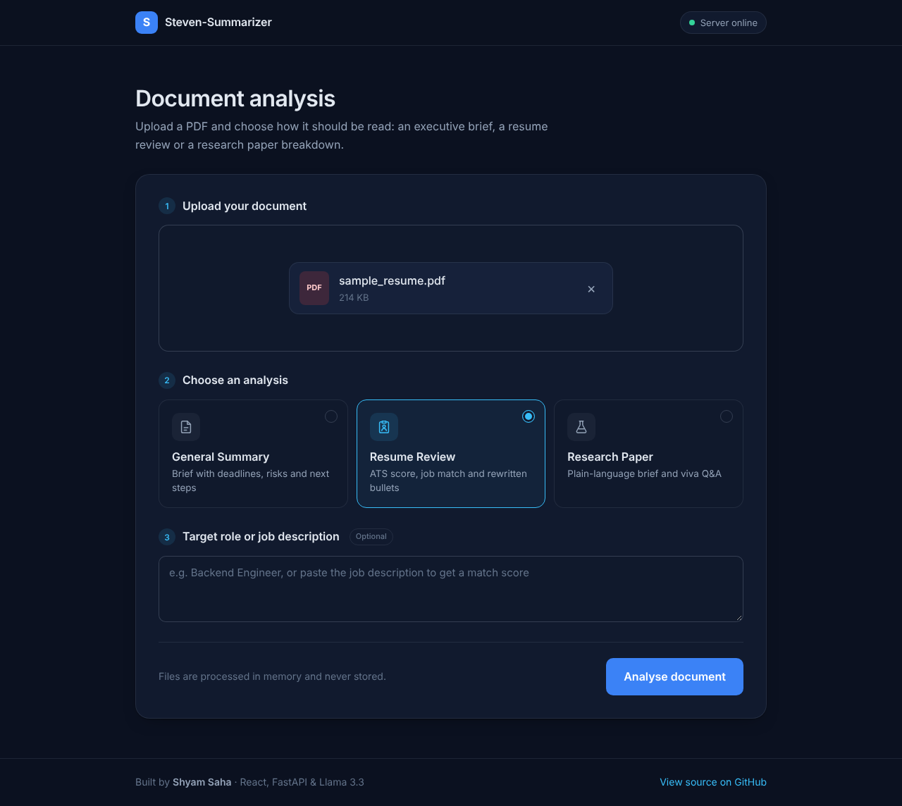
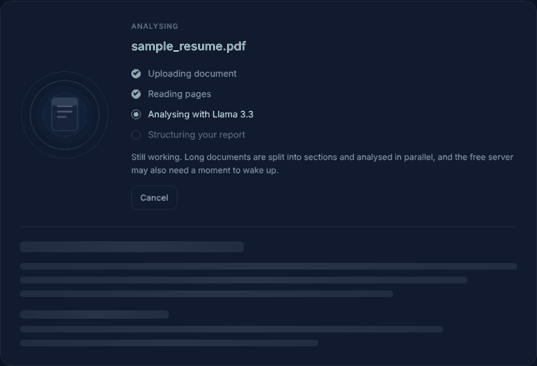
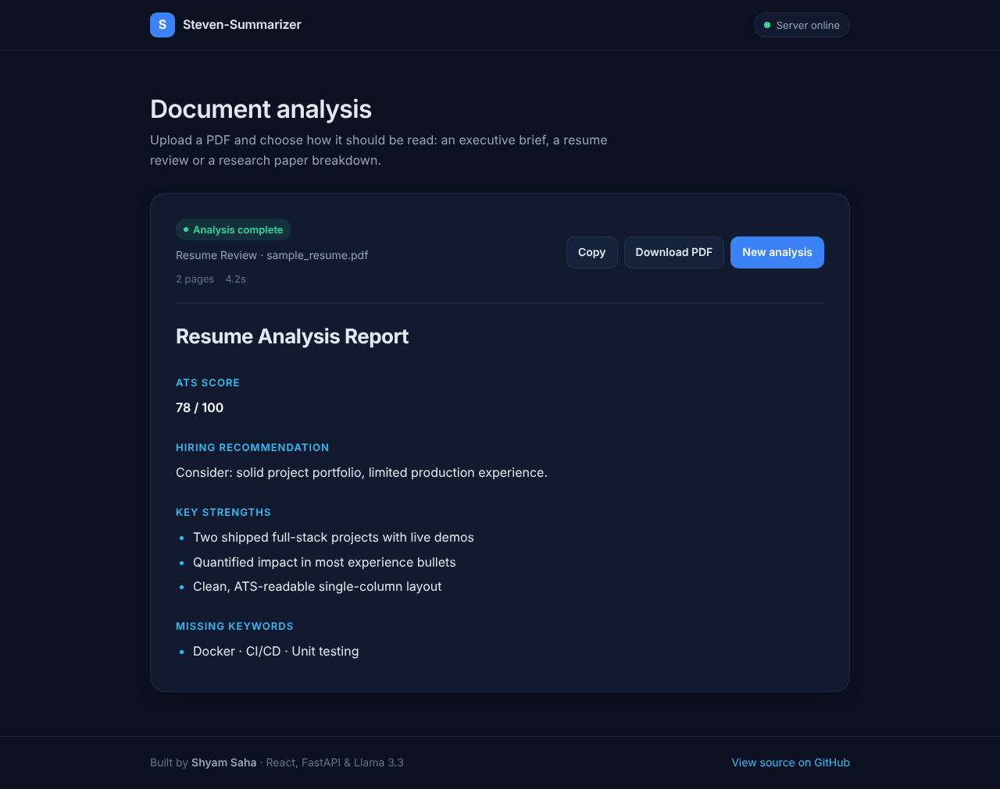
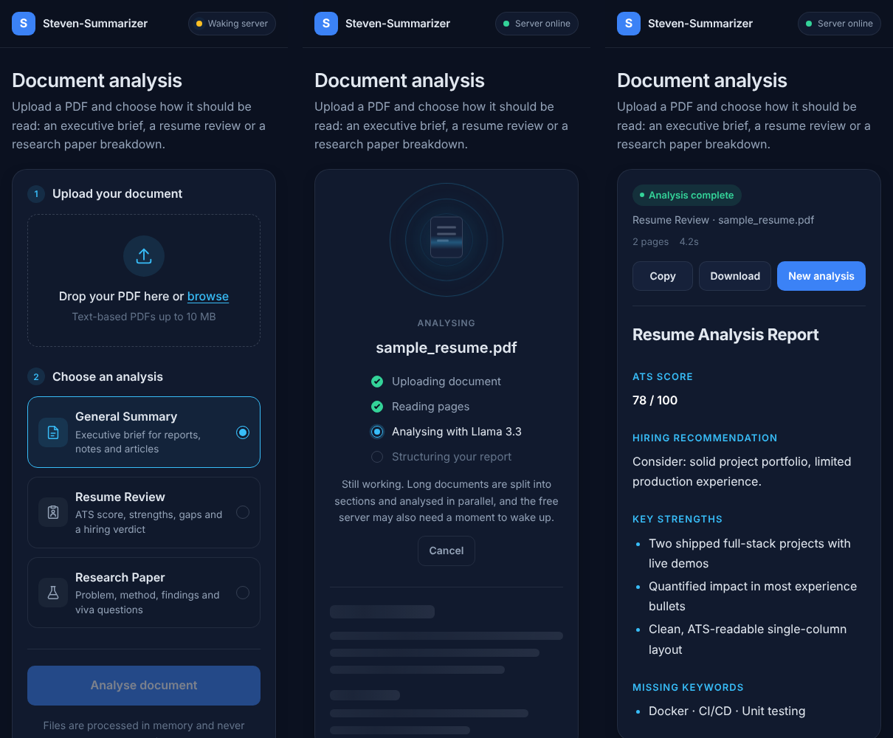
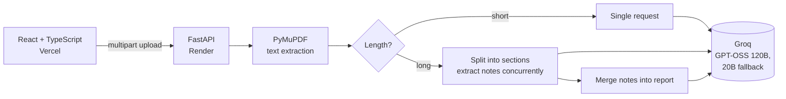

# Steven-Summarizer

[](https://github.com/stevesss01/Steven-Summarizer/actions/workflows/ci.yml)

Upload a PDF and get a structured analysis: an executive brief, a resume review or a
research paper breakdown. Long documents are split into sections, analysed concurrently
and merged, so file length doesn't make requests fail.

**Live:** https://steven-summarizer.vercel.app · **API docs:** https://steven-summarizer.onrender.com/docs



| Loading state | Result | Mobile |
| --- | --- | --- |
|  |  |  |

## Contents

- [Analysis modes](#analysis-modes)
- [Architecture](#architecture)
- [Handling long documents](#handling-long-documents)
- [Reliability](#reliability)
- [Prompt design](#prompt-design)
- [Running locally](#running-locally)
- [Configuration](#configuration)
- [API](#api)
- [Testing and CI](#testing-and-ci)
- [Deployment](#deployment)
- [Project structure](#project-structure)

## Analysis modes

| Mode | Optional context | Output |
| --- | --- | --- |
| General | A question about the document | Bottom line, direct answer to your question, key facts, deadlines and obligations table, risks and open questions, next steps |
| Resume | Target role or full job description | Criterion-by-criterion ATS score, recommendation, job match (matched and missing requirements), three weakest bullets rewritten, likely interview questions, top improvements |
| Research | What you need it for | Plain-language summary, approach and results with numbers, critical assessment, key terms, viva questions with model answers |

Every report can be downloaded as a formatted A4 PDF with a header, page numbers and tables.

## Architecture



## Handling long documents

The original version sent the first 12,000 characters in one request, so long PDFs either
lost most of their content or failed. The pipeline in
[`summarizer.py`](backend/app/services/summarizer.py) now works as follows:

1. **Short documents** (≤ `SINGLE_PASS_CHARS`) are analysed in one request.
2. **Long documents** are split on paragraph and sentence boundaries into overlapping
   sections ([`chunking.py`](backend/app/services/chunking.py)).
3. Each section is reduced to compact, mode-specific notes. Sections run **concurrently**,
   behind a process-wide semaphore that scales with the number of API keys.
4. If the merged notes are still too long, they are condensed again (up to three rounds).
5. The final report is generated from the notes using the mode's main prompt.

A section that fails is skipped instead of failing the request, as long as at least half
of the document was processed. If a request exceeds the model's context window, the
section is split in half and retried.

## Reliability

The previous implementation made a blocking, synchronous call from an async endpoint.
One slow request froze the server for every user, and any provider error became a 500.
[`llm_client.py`](backend/app/services/llm_client.py) replaces it with:

- **Async I/O** throughout, with PDF parsing moved to a worker thread.
- **Key rotation:** `GROQ_API_KEYS` accepts several keys, used round-robin to spread rate limits.
- **Retries** on timeouts, 429 and 5xx responses, with exponential backoff, jitter and `Retry-After` support.
- **Model fallback:** if the primary model keeps failing or has been retired, the request moves to `GROQ_FALLBACK_MODELS`. Model IDs are configuration, not code, so a provider deprecation only needs an environment variable change.
- **Rate limiting** per client IP (`RATE_LIMIT_PER_MINUTE`) to protect the shared API quota.
- **Structured request logs** with an `X-Request-ID` on every response, and a global handler that returns clean JSON errors.

## Prompt design

Prompts live in [`prompts.py`](backend/app/services/prompts.py).

- Instructions go in a **system message**. The document goes in the user message, wrapped in
  `<document>` tags, and the model is told to treat it as data. This blocks instructions
  hidden inside a PDF.
- **Grounding rule:** anything not present in the document is written as "Not stated"
  instead of being invented.
- The **resume ATS score uses an explicit rubric** (structure 20, keywords 25, quantified
  impact 20, experience 20, completeness 15). Each rating must cite evidence, which makes
  scores consistent between runs.
- **Actionable sections over summaries:** resume bullets are rewritten using placeholders such as `[X%]` instead of invented metrics, and viva questions come with model answers grounded in the paper.
- **Optional context** (a job description or a question) is passed in a separate `<context>` block and steers both the section notes and the final report.
- Each mode first **classifies the document** and adapts. Uploading a non-resume in Resume
  mode returns "Not a Resume" instead of a forced analysis.
- **Output is validated:** code fences and preambles are stripped, and an empty or malformed
  report is regenerated once.

## Running locally

Requires Python 3.11+, Node 22 and a [Groq API key](https://console.groq.com/keys).

```bash
# Backend
cd backend
python -m venv .venv && source .venv/bin/activate   # Windows: .venv\Scripts\activate
pip install -r requirements-dev.txt
cp .env.example .env                                 # add GROQ_API_KEY
uvicorn app.main:app --reload                        # http://localhost:8000/docs

# Frontend
cd frontend
npm ci
cp .env.example .env                                 # VITE_API_URL=http://localhost:8000
npm run dev                                          # http://localhost:5173
```

To run the backend with Docker instead:

```bash
docker build -t steven-summarizer-api backend
docker run -p 8000:8000 --env-file backend/.env steven-summarizer-api
```

## Configuration

Backend variables (see [`backend/.env.example`](backend/.env.example)):

| Variable | Default | Purpose |
| --- | --- | --- |
| `GROQ_API_KEY` / `GROQ_API_KEYS` | (required) | One key, or a comma-separated list for rotation |
| `GROQ_MODEL` | `openai/gpt-oss-120b` | Primary model |
| `GROQ_FALLBACK_MODELS` | `openai/gpt-oss-20b` | Models tried in order when the primary fails |
| `LLM_REASONING_EFFORT` | `low` | `low`, `medium` or `high` for reasoning models |
| `LLM_TIMEOUT_SECONDS` | `45` | Timeout for each request |
| `LLM_MAX_RETRIES` | `3` | Attempts per model |
| `SINGLE_PASS_CHARS` | `12000` | Above this size, use sectioned analysis |
| `CHUNK_CHARS` / `CHUNK_OVERLAP_CHARS` | `8000` / `400` | Section size and overlap |
| `MAX_CONCURRENCY` | `3` | Concurrent section requests per API key |
| `MAX_DOCUMENT_CHARS` / `MAX_PAGES` | `120000` / `200` | Upper bounds on processed content |
| `MAX_UPLOAD_MB` | `10` | Upload size limit |
| `RATE_LIMIT_PER_MINUTE` | `10` | Analyses per client IP per minute (0 disables) |
| `ALLOWED_ORIGINS` | localhost, Vercel URL | CORS allow-list |
| `LOG_LEVEL` | `INFO` | Logging level |

Frontend: `VITE_API_URL`, the backend base URL.

## API

`POST /summarize` (multipart form)

| Field | Type | Notes |
| --- | --- | --- |
| `file` | PDF | Up to 10 MB, must contain selectable text |
| `mode` | `general` \| `resume` \| `research` | Defaults to `general` |
| `context` | string, optional | Up to 4,000 characters: target role, job description or question |

```json
{
  "summary": "# Resume Analysis\n...",
  "mode": "resume",
  "meta": {
    "pages": 2,
    "pages_analysed": 2,
    "sections": 1,
    "truncated": false,
    "models": ["openai/gpt-oss-120b"],
    "seconds": 4.2
  }
}
```

| Status | Meaning |
| --- | --- |
| 400 | Unreadable PDF |
| 413 | File too large |
| 415 | Not a PDF |
| 422 | No extractable text (for example a scanned PDF), or invalid mode |
| 429 | Rate limit exceeded (`Retry-After` header set) |
| 503 | AI provider unavailable after retries and fallbacks |

`POST /export/pdf` (JSON `{ "markdown", "title", "source_name" }`) returns the report as
`application/pdf`, rendered server-side with ReportLab.

`GET /health` is used as the Render health check, and the frontend calls it on load to wake the server.

## Testing and CI

```bash
cd backend
ruff check . && ruff format --check .
pytest -q
```

The tests cover chunking, the map-reduce pipeline (concurrency cap, partial failures,
context-overflow fallback, truncation), the LLM client (key rotation, retries, model
fallback, context errors), prompt structure and HTTP behaviour. They use a fake LLM
client, so no API key or network access is needed.

[GitHub Actions](.github/workflows/ci.yml) runs lint, format checks and tests for the
backend, and lint, format check and production build for the frontend, on every push
and pull request.

## Deployment

- **Backend:** Render, configured in [`render.yaml`](render.yaml), with `/health` as the health check. Set `GROQ_API_KEY` (or `GROQ_API_KEYS`) and `ALLOWED_ORIGINS` in the dashboard.
- **Frontend:** Vercel, with security and caching headers in [`frontend/vercel.json`](frontend/vercel.json). Set `VITE_API_URL`.

The rate limiter is in-memory and assumes a single backend instance. To scale out
horizontally, move it to Redis.

## Project structure

```text
backend/
  app/
    api/summarize.py        analysis endpoint and validation
    api/export.py           PDF export endpoint
    core/                   settings, logging middleware, rate limiter
    services/
      chunking.py           boundary-aware text splitting
      llm_client.py         async Groq client: rotation, retries, fallback
      pdf_service.py        PyMuPDF extraction (threaded)
      pdf_export.py         markdown report to A4 PDF (ReportLab)
      prompts.py            system prompts and message builders
      summarizer.py         single-pass and map-reduce pipeline
    main.py                 app setup, middleware, error handling
  tests/
  Dockerfile
frontend/
  src/
    components/             UI components (upload, mode selector, loading, result)
    hooks/                  useSummarize, useServerStatus
    services/api.ts         typed API client
    styles/global.css       design tokens, layout, motion
  vercel.json
.github/workflows/ci.yml
render.yaml
```

## Author

Shyam Saha · Electronics and Communication Engineering · [GitHub](https://github.com/stevesss01)
