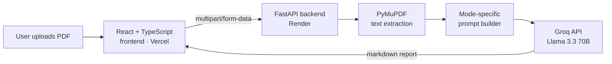

<div align="center">

# Steven-Summarizer

**AI document intelligence. Upload a PDF and get a structured, decision-ready analysis in seconds.**

[](https://steven-summarizer.vercel.app)


</div>

---

## Overview

Reading long PDFs to find the few points that matter is slow and repetitive. Steven-Summarizer automates it:

1. **Upload** a PDF (drag-and-drop or browse)
2. **Choose** an analysis mode
3. **Receive** a structured markdown report you can copy or download

Each mode uses a purpose-built prompt, so the output fits the document: a resume gets an ATS score and a hiring verdict, and a research paper gets its contributions, limitations and likely viva questions.

## Features

| Mode | Best for | What you get |
| --- | --- | --- |
| 📄 **General Summary** | Reports, notes, articles | Executive brief: overview, key takeaways, critical facts, recommended actions, keywords |
| 🧑‍💼 **Resume Review** | CVs and resumes | ATS score, hiring recommendation, strengths, gaps, missing keywords, technical ratings |
| 🔬 **Research Paper** | Academic and technical papers | Problem, proposed solution, contributions, findings, limitations, viva questions |

**User experience**

- Calm, animated loading states: a boot splash, breathing progress visual, step tracker and shimmering report skeleton
- The server is woken in the background as soon as the page opens, which hides most of the free-tier cold start
- Fully responsive layout for mobile, tablet and desktop, with keyboard-accessible controls
- Clear error messages for wrong file types, oversized files, scanned PDFs and network failures
- No sign-up and no storage: files are processed in memory

<div align="center">

<br/><br/>

<br/><br/>

</div>

## Architecture



**Request flow**

1. The frontend validates the file (PDF only, ≤ 10 MB) and posts it with the selected mode.
2. The backend validates it again, extracts text with PyMuPDF and rejects empty or scanned documents.
3. The prompt for that mode is built and sent to Llama 3.3 70B on Groq.
4. The markdown response is rendered in the browser, with copy and download options.

## Tech Stack

| Layer | Technology | Why |
| --- | --- | --- |
| Frontend | React 19, TypeScript, Vite | Typed, component-based UI with a fast dev/build loop |
| Rendering | react-markdown | Safe rendering of the model's markdown output |
| HTTP | Axios | Request cancellation, timeouts and typed responses |
| Backend | FastAPI, Python | Async API with automatic validation and OpenAPI docs (`/docs`) |
| PDF parsing | PyMuPDF | Fast, accurate text extraction |
| LLM | Groq · Llama 3.3 70B Versatile | Low-latency inference on a strong open model |
| Hosting | Vercel (frontend), Render (backend) | Free-tier friendly deployment |

## Project Structure

```text
Steven-Summarizer/
├── backend/
│   ├── app/
│   │   ├── api/
│   │   │   └── summarize.py      # POST /summarize — validation & error handling
│   │   ├── core/
│   │   │   └── config.py         # Environment-driven settings
│   │   ├── services/
│   │   │   ├── groq_service.py   # LLM client wrapper
│   │   │   ├── pdf_service.py    # PDF text extraction
│   │   │   └── prompts.py        # Prompt templates per analysis mode
│   │   └── main.py               # App factory, CORS, health check
│   ├── .env.example
│   └── requirements.txt
├── frontend/
│   ├── public/                   # Favicon and static assets
│   ├── src/
│   │   ├── components/           # Header, UploadZone, ModeSelector, LoadingState, ResultPanel…
│   │   ├── config/modes.ts       # Analysis mode definitions
│   │   ├── hooks/                # useSummarize, useServerStatus
│   │   ├── pages/Home.tsx        # Page composition
│   │   ├── services/api.ts       # API client
│   │   └── styles/global.css     # Design tokens, layout, animations
│   ├── .env.example
│   └── index.html                # Includes the boot splash
├── docs/screenshots/
└── README.md
```

## Getting Started

### Prerequisites

- Python 3.11+
- Node.js 20+
- A free [Groq API key](https://console.groq.com/keys)

### 1. Backend

```bash
cd backend
python -m venv venv

# Windows
venv\Scripts\activate
# macOS / Linux
source venv/bin/activate

pip install -r requirements.txt
cp .env.example .env          # then add your GROQ_API_KEY
uvicorn app.main:app --reload
```

The API runs at `http://localhost:8000`, with interactive docs at `http://localhost:8000/docs`.

### 2. Frontend

```bash
cd frontend
npm install
cp .env.example .env          # points the app at http://localhost:8000
npm run dev
```

Open `http://localhost:5173`.

## Configuration

**Backend (`backend/.env`)**

| Variable | Required | Default | Description |
| --- | --- | --- | --- |
| `GROQ_API_KEY` | ✅ | — | Groq API key |
| `GROQ_MODEL` | | `llama-3.3-70b-versatile` | Model used for analysis |
| `GROQ_TEMPERATURE` | | `0.3` | Sampling temperature |
| `MAX_INPUT_CHARS` | | `12000` | Characters of extracted text sent to the model |
| `MAX_UPLOAD_MB` | | `10` | Maximum upload size |
| `ALLOWED_ORIGINS` | | localhost + Vercel URL | Comma-separated CORS origins |

**Frontend (`frontend/.env`)**

| Variable | Default | Description |
| --- | --- | --- |
| `VITE_API_URL` | `https://steven-summarizer.onrender.com` | Backend base URL |

## API Reference

### `POST /summarize`

| Field | Type | Description |
| --- | --- | --- |
| `file` | PDF file | Document to analyse (≤ 10 MB) |
| `mode` | `general` \| `resume` \| `research` | Analysis type (default `general`) |

```json
{ "summary": "# Executive Brief\n\n## Overview\n...", "mode": "general" }
```

| Status | Meaning |
| --- | --- |
| `400` | File could not be read as a PDF |
| `413` | File exceeds the size limit |
| `415` | Not a PDF |
| `422` | No extractable text (for example, a scanned PDF) or an invalid mode |
| `502` | The AI service failed or is not configured |

### `GET /health`

Returns `{ "status": "ok" }`. The frontend calls it on page load to wake the server early.

## Roadmap

- [ ] OCR support for scanned PDFs
- [ ] Export reports as PDF
- [ ] Multi-document comparison
- [ ] Streaming responses for faster first output
- [ ] Chunked summarisation for very long documents

## Author

**Shyam Saha**: Electronics and Communication Engineering

Interested in artificial intelligence, full-stack development, data analytics and intelligent systems.

[GitHub](https://github.com/stevesss01)
